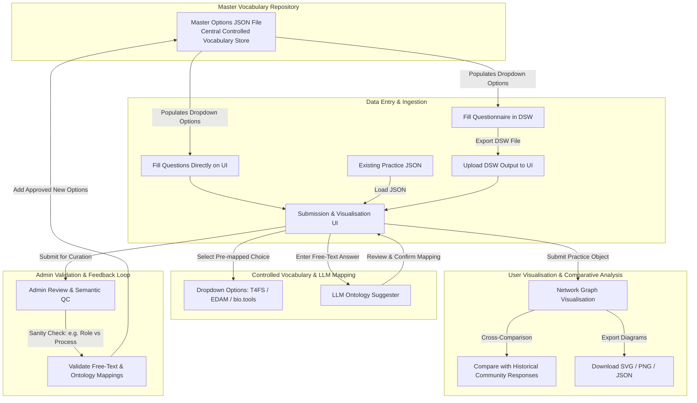

# Abstract

Interoperability practices developed by research projects, institutes, platforms, and scientific communities are often distributed across presentation slides, internal wikis, spreadsheets, and email threads. This makes the practices difficult to discover, compare, improve, and reuse. Project 5 at BioHackathon Europe 2026 addressed this problem by developing a submission and visualisation workflow for sharing structured community interoperability practices across the research data management ecosystem.

The project built on an existing questionnaire organised around stages of the RDMkit Data Life Cycle. The questionnaire captures the context of a practice, the tasks performed, the tools and resources used, the people or roles involved, and relevant constraints. During the BioHackathon, the team reviewed the questions to identify where registries, ontologies, controlled vocabularies, and community standards could support structured answers. The team also developed requirements for a user interface, considered routes for importing Data Stewardship Wizard output and existing JSON records, and designed visualisation levels ranging from an overview of a community practice to detailed views of lifecycle phases, tasks, tools, and contributions.

The resulting design combines controlled selections with free-text input and a proposed human-reviewed terminology-suggestion process. It supports machine-readable export and visual comparison while retaining the original community description. Deployed via GitHub Pages alongside public documentation, the work provides an open, maintainable foundation through which communities can submit, discover, compare, and iteratively improve interoperability practices.

# Introduction

Research communities repeatedly address similar operational questions: how data and metadata are captured, which identifiers and file formats are used, which tools support a task, how outputs are deposited, and how workflows can be reproduced. The resulting practices are frequently documented for a local audience rather than represented as reusable objects. Relevant information may be spread across slides, internal documentation, spreadsheets, and correspondence. Consequently, a researcher or data steward may find it difficult to determine what another community does for a comparable task or which standards and tools are already in use.

An ongoing ELIXIR Interoperability Platform activity has used guided interviews and a questionnaire structured around the RDMkit Data Life Cycle to capture such practices. The guided approach helps participants interpret the questions, but it limits scalability because completion depends on facilitator time and subsequent manual synthesis. Project 5 therefore set out to translate the interview process into a lightweight, self-service submission and visualisation workflow.

The project goal was not to define a single universal workflow. Instead, the intended resource records practices in their community and task context, connects answers to relevant FAIR-enabling resources where appropriate, and allows users to inspect similarities, differences, and gaps. Potentially linked resources include RDMkit, the FAIR Cookbook, FAIRsharing, bio.tools, software repositories, repository registries, community standards, and ontologies.

This report describes the design work, questionnaire mapping, prototype workflow, cross-project discussions, and remaining implementation decisions from BioHackathon Europe 2026 Project 5, “A submission and visualisation interface for sharing community interoperability practices.”

The project had five objectives:

1. Convert the existing guided questionnaire into a workflow that stakeholders can complete directly.

2. Represent submitted practices in a structured form suitable for machine-readable export, initially JSON and YAML.

3. Identify questionnaire fields that can use controlled terms from ontologies, registries, community standards, databases, or role vocabularies.

4. Develop visualisation requirements that support both a community overview and detailed inspection of lifecycle phases, tasks, tools, inputs, outputs, and contributions.

5. Define a curation loop through which free-text answers and proposed mappings can be reviewed before becoming reusable options for later submissions.

The intended users include researchers seeking examples from comparable domains, data stewards looking for operational practices, community coordinators documenting a shared process, and maintainers of RDM ecosystem resources interested in linking practice descriptions to relevant guidance, standards, tools, and registries.

# Approach

## Starting materials and design inputs

The work started from the existing lifecycle-based survey questions, supporting spreadsheets, example answers, project slides, a sign-up sheet, and the project repository. The current process combines guided interviews with manual mapping and synthesis. The BioHackathon work examined how this process could be decomposed into reusable technical components without removing the context supplied by respondents.

The team organised the work into four connected streams:

1. Interface requirements and implementation.

2. Mapping questionnaire fields to ontologies, registries, databases, tools, documents, standards, and role vocabularies.

3. A feedback process in which reviewed answers can populate later dropdown menus.

4. Interlinking with the wider RDM ecosystem.

## Questionnaire and terminology mapping

Each questionnaire item was reviewed to identify: the concept that the question aims to capture; the type of resource that could support the answer; and candidate values, registries, standards, or ontologies suitable for a dropdown menu or suggested mapping. The resource categories included databases, tools, ontologies, registries, individual documents, community standards, and role vocabularies.

Examples considered during the mapping included EDAM for data and analysis operations, bio.tools for software resources, re3data for repositories, FAIRsharing for standards and databases, and role vocabularies for responsibility and contribution statements. The mapping was treated as a candidate layer for human review, not as an automatic replacement for a respondent’s original wording.

## Submission and curation workflow

The proposed workflow supports three entry routes: completion through the Data Stewardship Wizard followed by import; direct completion in the submission interface; and loading of an existing practice object represented in JSON. A master options file supplies reviewed values for structured fields.

Where a suitable reviewed option exists, the user selects it from a dropdown menu. Where no suitable option exists, the user enters free text. A terminology-suggestion component may propose candidate mappings, but the user or curator must review the suggestion. New values are added to the master options only after semantic and contextual review. This is intended to reduce mismatches such as assigning a role term to a process or treating a software resource as a standard.



## Visualisation requirements

The design discussions identified several levels of inspection:

1. A community-level view organised around the research data lifecycle.

2. A multi-community view for comparison across domains or topics.

3. A phase-level view covering one or more selected lifecycle stages.

4. A task-level view exposing tools, inputs, outputs, roles, contributions, and the original answer when a suggested mapping has been applied.

Suggested interaction patterns included a lifecycle wheel, search by topic or data type, visual indication of incomplete sections, and a detail card for an individual task. Additional perspectives considered included data-centred, role-centred, community-centred, and Node-expertise views.

# Results

## Questionnaire-to-resource mapping

The team reviewed all 41 questionnaire items across seven lifecycle sections and classified each item by target concept, expected resource type, and candidate controlled vocabularies or registries (Table 1). Across the survey, role-related questions were mapped to Terms4FAIRskills (`T4FS:0000178`) and the Contributor Role Ontology (`CRO`), while domain operations, formats, software, repositories, and access conditions were linked to established registries and ontologies.

Table: Summary of questionnaire sections mapped to resource types and candidate vocabularies or registries.

| Lifecycle section | Target concepts | Resource types | Candidate ontologies and registries | 
| ----- | ----- | ----- | ----- | 
| **1. Plan** | Authoring tools, storage, validation, guidance, roles | tool, database, registry, individual document, community standard, roles | DSW, FAIRsharing, RDMkit, `T4FS` | 
| **2. Collect** | Object types, formats, SOPs, persistent identifiers, QA roles | ontology, tool, community standard, registry, roles | EDAM (`format`), FAIRsharing, DataCite, `T4FS` | 
| **3. Process** | Cleaning steps, standardisation, integrity checks, QC roles | tool, community standard, roles | EDAM (`operation`), WorkflowHub, `T4FS` | 
| **4. Analyse** | Analytical methods, software, reproducibility, visualisation, training | ontology, tool, registry, community standard, roles | EDAM, SWO, bio.tools, ELIXIR TeSS, FAIR Cookbook | 
| **5. Preserve** | Repositories, backups, archiving policies, certification | database, tool, individual document, community standard, roles | re3data, FAIRsharing, CoreTrustSeal, `T4FS` | 
| **6. Share** | Shared objects, platforms, legal/ethical constraints, metadata | database, individual document, community standard, roles | Zenodo, ENA, DUO, Dublin Core, `T4FS` | 
| **7. Reuse** | Reuse planning, standards, licences, discoverability | community standard, individual document, registry, roles | SPDX, DataCite, Schema.org, `T4FS` | 

## Prototype submission, visualisation, and GitHub-hosted deployment

An initial prototype web interface (`https://bh.bilgehan.nl/submit`) was implemented alongside Data Stewardship Wizard (DSW) templates, both drawing dropdown options from a shared JSON options file. To support transparent community participation and long-term sustainability, a GitHub-hosted version of the submission interface (`https://biocorecrg.github.io/biohackathon-community-practices-2026/submit`) and accompanying documentation site (`https://biocorecrg.github.io/biohackathon-community-practices-2026/docs/`) were also established. Hosting the application and documentation via GitHub enables open community contributions to both practice content (such as seed submissions and reviewed vocabulary options) and ongoing website maintenance via standard pull-request workflows.

Within the interface, respondents can select pre-mapped terms or enter free text, inspect ontology mappings proposed for free-text entries prior to submission, compare submitted practices in a network view against existing community records, and export diagrams as SVG, PNG, or JSON. To support curation, synthetic test responses were used to prototype an LLM-assisted terminology-suggestion pipeline for free-text answers and to define an admin review workflow, enabling curators to verify semantic appropriateness (for example, distinguishing role descriptors from process steps) before appending approved options to the master JSON file.

## Visualisation mockups and seed examples

UI mockups were produced for the lifecycle wheel overview, topic and data-type search, visual masking of incomplete sections, and task-level detail cards. Initial seed records from participating ELIXIR communities (including biodiversity, toxicology, and rare diseases) were prepared to test the end-to-end workflow and demonstrate the interface during the hackathon poster session.

# Discussion

## Cross-project discussions and ecosystem alignment

Cross-project exchanges helped align the practice schema with complementary BioHackathon efforts:

* **Credit and recognition (Project #6):** Discussions examined how granular role annotations captured via `T4FS` and `CRO` can support attribution for data stewards, bioinformaticians, and other contributors.

* **Tool registries and linking strategies (Project #20):** Discussions with `bio.tools` contributors explored linking workflow tasks directly to tool registry entries, while exchanges on cross-document linking informed strategies for connecting practice records across RDMkit Tool Assemblies and GitHub repositories.

* **Project #3 (semantic framework standards)** was also reviewed and identified as a prospective contributor of community records once the interface is populated.

## Remaining decisions and next steps

Several technical and governance tasks remain before wider community deployment:

1. **Ecosystem integration and automated synchronisation:** Building on the GitHub-hosted deployment and documentation site, establish automated push/pull synchronisation workflows linking practice records and master vocabulary options with RDMkit Tool Assemblies, DSW knowledge models, and FAIRsharing.

2. **Suggestion pipeline and curation governance:** Deploying the LLM suggestion cache in production and establishing lightweight editorial rules for reviewing pull requests and new master options.

3. **Community testing and naming:** Expanding seed examples across additional domains, validating usability with data stewards, and finalising a permanent name for the tool.

## Acknowledgements

We thank the BioHackathon Europe 2026 organisers, ELIXIR Europe, and the ELIXIR Interoperability Platform for supporting Project 5.

# References

```
\AtEndDocument{%

```

